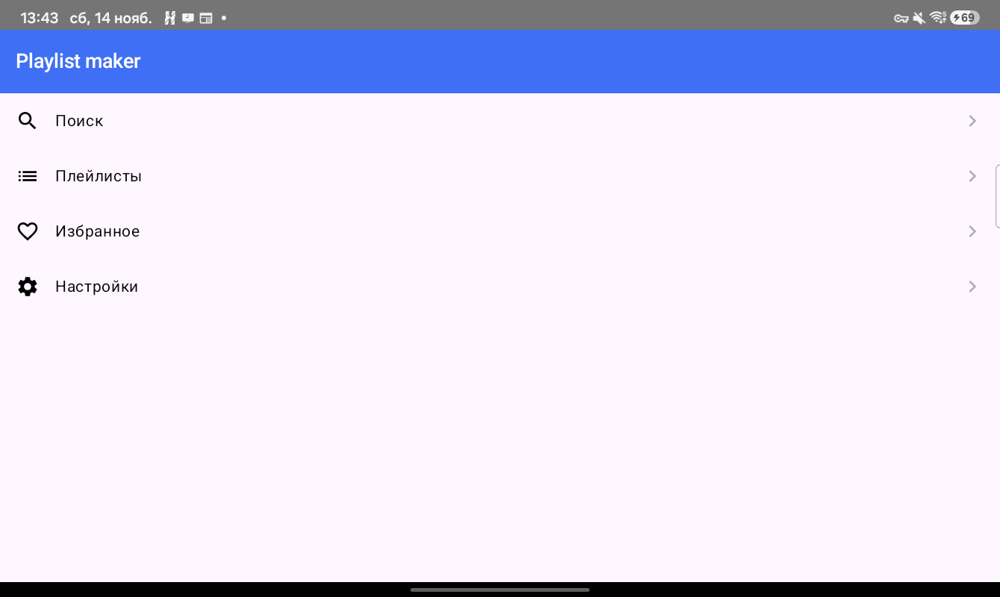

# Playlist maker

Учебный проект на Jetpack Compose: главный экран приложения и переходы на экраны поиска и настроек.

## Возможности

- Главный экран с заголовком `Playlist maker` и пунктами меню: Поиск, Плейлисты, Избранное, Настройки.
- Переход на экран поиска при нажатии на `Поиск`.
- Переход на экран настроек при нажатии на `Настройки`.
- Для `Плейлисты` и `Избранное` обработчики пока пустые.

## Скриншоты

### Главный экран



### Поиск


### Настройки


## Сборка

```bash
./gradlew :app:assembleDebug
```

APK: `app/build/outputs/apk/debug/app-debug.apk`.
