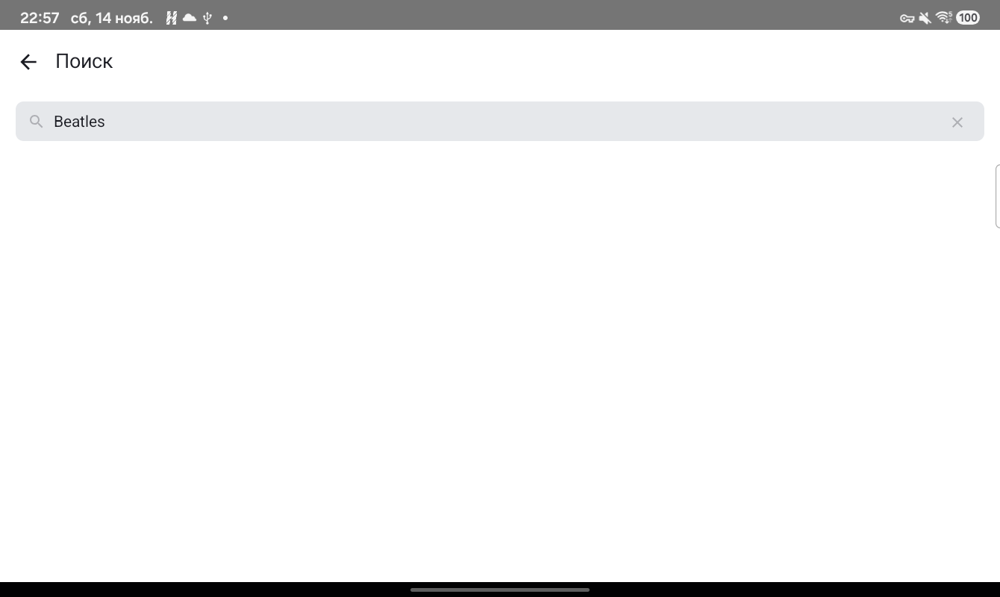
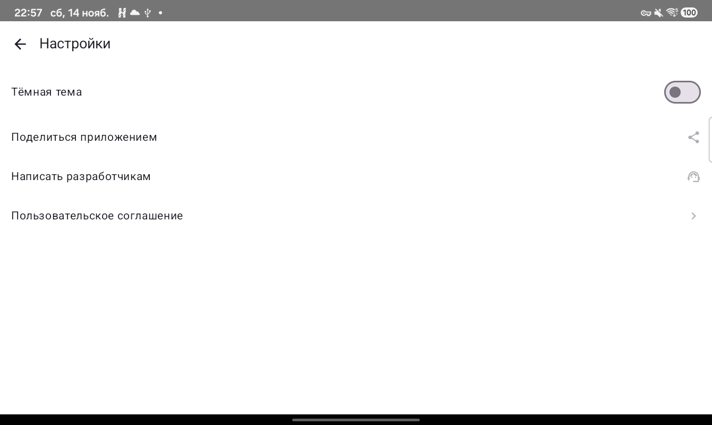
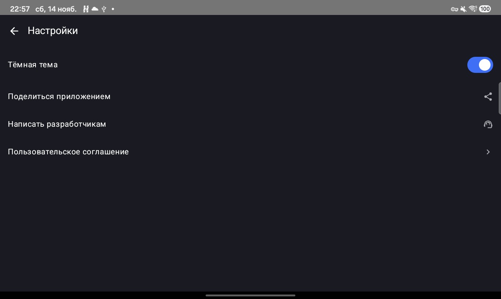
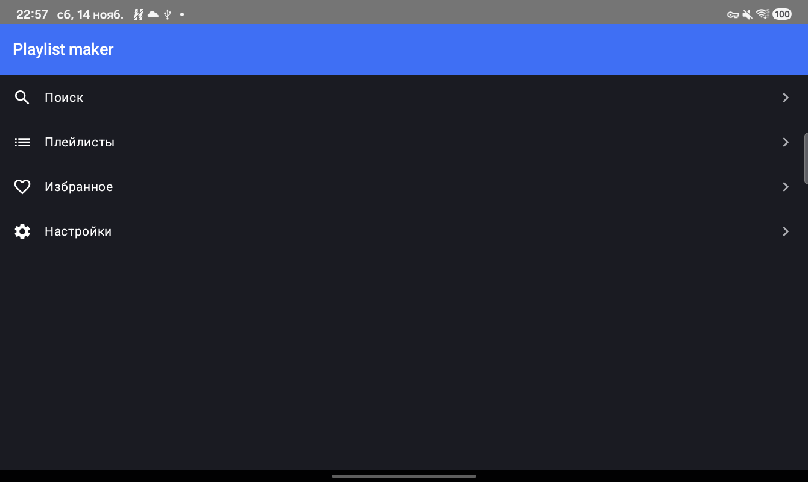

# Playlist maker

Учебный проект на Jetpack Compose: главный экран, экраны поиска и настроек, навигация между ними.

## Возможности

- Главный экран с заголовком `Playlist maker` и пунктами меню: Поиск, Плейлисты, Избранное, Настройки.
- Навигация между экранами через `NavHost` и `NavController`.
- Экран поиска: поисковая строка с подсказкой `Поиск`, иконкой поиска и кнопкой очистки запроса. Логика поиска пока не реализована.
- Экран настроек: переключение тёмной темы, шеринг приложения, письмо разработчикам, переход к пользовательскому соглашению.
- Все тексты и ссылки вынесены в `strings.xml`.

## Скриншоты

### Главный экран


### Поиск



### Настройки



### Тёмная тема





## Сборка

```bash
./gradlew :app:assembleDebug
```

APK: `app/build/outputs/apk/debug/app-debug.apk`.
